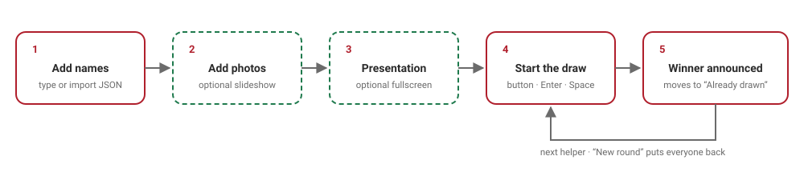
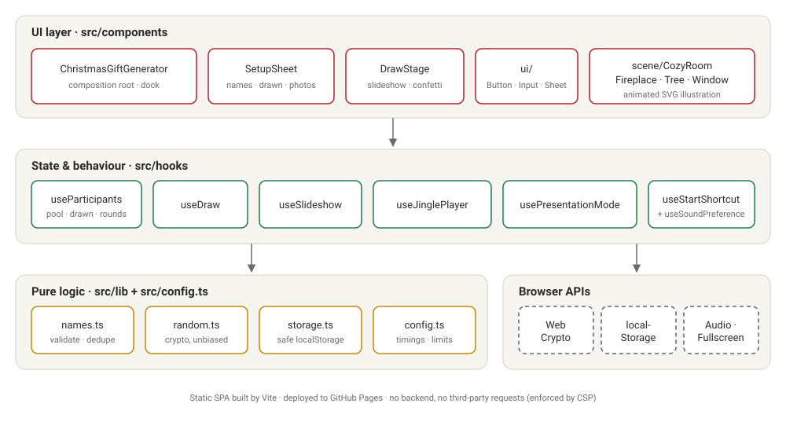

<p align="center">
  
</p>

<p align="center">
  <a href="https://github.com/noe412/Christmas_Generator/actions/workflows/ci.yml"></a>
  <a href="https://github.com/noe412/Christmas_Generator/actions/workflows/deploy.yml"></a>
  <a href="https://github.com/noe412/Christmas_Generator/actions/workflows/codeql.yml"></a>
  <a href="LICENSE"></a>
  
</p>

<p align="center">
  <b>Faire, festliche Zufallsauslosung, wer dieses Jahr die Geschenke verteilt.</b><br />
  100 % im Browser · keine Server · keine Tracker · präsentationsfertig für Beamer &amp; TV.
</p>

<p align="center">
  <a href="https://noe412.github.io/Christmas_Generator/"><b>▶ Live-Demo</b></a> ·
  <a href="docs/USER_GUIDE.md">Benutzerhandbuch</a> ·
  <a href="docs/ARCHITECTURE.md">Architektur</a> ·
  <a href="docs/DEPLOYMENT.md">Deployment</a>
</p>

---

## Screenshots


| Gewinner                                        | Einrichtung                                 | Mobil                                                                    |
| ----------------------------------------------- | ------------------------------------------- | ------------------------------------------------------------------------ |
|  |  |  |

## Features

- 🔥 **Cozy Winter Wonderland** – animierter Kamin mit Glut und Kerzen, geschmückter Baum mit Lichterkette, verschneites Fenster; komplett als eigene SVG/CSS-Illustration.
- 🎲 **Faire Auslosung** – Web Crypto API mit Rejection Sampling, kein Modulo-Bias.
- 🔁 **Runden** – Gezogene landen unter „Already drawn“; „New round“ legt alle zurück in den Hut.
- 🎉 **Großer Auftritt** – Namens-Shuffle mit Fortschrittsbalken, goldener Gewinnername und Konfetti.
- 💾 **Persistenz & Austausch** – Teilnehmer, Runde und Ton-Einstellung bleiben lokal gespeichert; Import/Export als JSON.
- 🖼️ **Slideshow** – eigene Fotos laufen hinter der Auslosung.
- 🖥️ **Präsentationsmodus** – Vollbild mit großer Bühne und kompakter Steuerung.
- 🎵 **Jingles** – zufälliger Weihnachtssound, per Klick stummschaltbar.
- ⌨️ **Tastatursteuerung** – Start mit `Enter` / `Leertaste`.
- ♿ **Barrierearm** – fokussierbare Schublade (Radix Dialog), Live-Regionen, `prefers-reduced-motion`.
- 🔒 **Privacy by Design** – strikte CSP, selbst gehostete Schriften, keine externen Requests.

## Ablauf



## Schnellstart

```bash
git clone https://github.com/noe412/Christmas_Generator.git
cd Christmas_Generator
npm ci
npm run dev
```

Anschließend <http://localhost:8080> öffnen. Voraussetzung: Node.js 26 LTS (empfohlen, siehe `.nvmrc`), mindestens 22.12.

## Scripts

| Befehl                  | Beschreibung                              |
| ----------------------- | ----------------------------------------- |
| `npm run dev`           | Entwicklungsserver mit HMR                |
| `npm run build`         | Typecheck + Production-Build nach `dist/` |
| `npm run preview`       | Production-Build lokal ausliefern         |
| `npm test`              | Unit- & Integrationstests (Vitest)        |
| `npm run test:coverage` | Tests mit Coverage-Report                 |
| `npm run lint`          | ESLint (0 Warnungen erlaubt)              |
| `npm run typecheck`     | TypeScript im `strict`-Modus              |
| `npm run format`        | Code mit Prettier formatieren             |
| `npm run ci`            | Komplette Pipeline wie in GitHub Actions  |

## Tech-Stack

| Bereich     | Technologie                                                   |
| ----------- | ------------------------------------------------------------- |
| Framework   | React 18 · TypeScript (strict)                                |
| Build       | Vite 7 · SWC                                                  |
| Styling     | Tailwind CSS 4 · Radix Dialog/Slot · class-variance-authority |
| Icons/Fonts | lucide-react · Fraunces & Inter (@fontsource, self-hosted)    |
| Qualität    | Vitest · Testing Library · ESLint · Prettier · CodeQL         |
| Delivery    | GitHub Actions · GitHub Pages · Dependabot                    |

## Architektur



Details: [docs/ARCHITECTURE.md](docs/ARCHITECTURE.md) · Konfiguration: [docs/CONFIGURATION.md](docs/CONFIGURATION.md)

## Sicherheit & Datenschutz

Die Anwendung verarbeitet Daten ausschließlich lokal im Browser. Es gibt kein Backend, keine Cookies und kein Tracking. Sicherheitslücken bitte gemäß [SECURITY.md](SECURITY.md) melden.

## Mitwirken

Beiträge sind willkommen – siehe [CONTRIBUTING.md](CONTRIBUTING.md). Änderungen werden im [CHANGELOG](CHANGELOG.md) dokumentiert.

## Lizenz

Veröffentlicht unter der [MIT-Lizenz](LICENSE). Für die Sounds in `src/assets/sounds/` gelten ggf. eigene Rechte – siehe [docs/ASSETS.md](docs/ASSETS.md).
