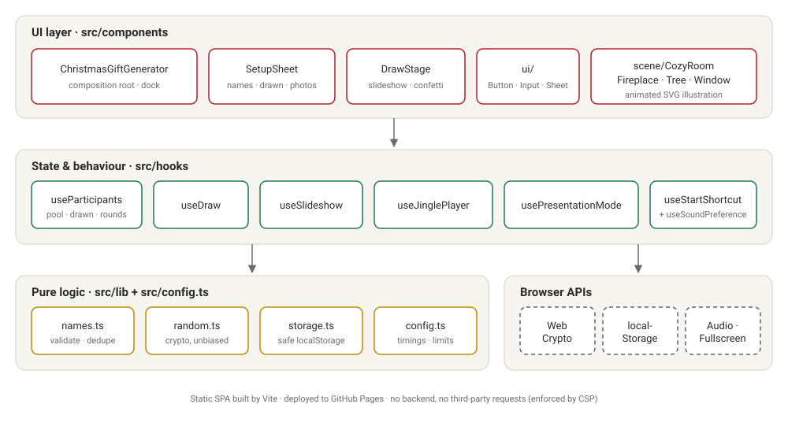

# Architektur



## Überblick

Der Christmas Gift Generator ist eine **statische Single-Page-Application** (React 18, TypeScript, Vite, Tailwind CSS). Es gibt kein Backend: Build-Artefakte werden auf GitHub Pages (oder jedem beliebigen Static Host) ausgeliefert.

## Schichten

| Schicht       | Ort              | Verantwortung                                            | Testbarkeit        |
| ------------- | ---------------- | -------------------------------------------------------- | ------------------ |
| UI            | `src/components` | Darstellung, Barrierefreiheit, Layout                    | Integrationstests  |
| Zustand       | `src/hooks`      | State, Seiteneffekte (Timer, Audio, Fullscreen, Storage) | `renderHook`-Tests |
| Logik         | `src/lib`        | Reine Funktionen: Validierung, Zufall, Serialisierung    | Unit-Tests         |
| Konfiguration | `src/config.ts`  | Zeiten, Limits, Storage-Key                              | –                  |

Abhängigkeiten zeigen nur nach unten: Komponenten → Hooks → Lib/Config → Browser-APIs.

## Verzeichnisstruktur

```text
src/
├── App.tsx                     # ErrorBoundary + Root-Komponente
├── main.tsx                    # Einstiegspunkt, Schriften, StrictMode
├── config.ts                   # Zentrale Konfiguration
├── index.css                   # Design-Tokens, Basis-Styles
├── assets/                     # Hintergrundbild, Sounds (*.mp3 werden automatisch erkannt)
├── components/
│   ├── ChristmasGiftGenerator.tsx  # Composition Root
│   ├── ParticipantsPanel.tsx       # Namen verwalten, Import/Export
│   ├── SlideshowPanel.tsx          # Bilder hochladen/entfernen
│   ├── DrawStage.tsx               # Bilderrahmen, Slideshow, Gewinneranzeige
│   ├── FitToViewport.tsx           # Skalierung im Präsentationsmodus
│   ├── Snowfall.tsx · AppHeader.tsx · ErrorBoundary.tsx
│   └── ui/                         # Basis-Komponenten (Button, Card, Input)
├── hooks/
│   ├── useParticipants.ts      # Liste + Persistenz + Import/Export
│   ├── useDraw.ts              # Auslosungs-Zustandsautomat
│   ├── useSlideshow.ts         # Object-URLs + Auto-Advance
│   ├── useJinglePlayer.ts      # Audio
│   ├── usePresentationMode.ts  # Fullscreen-Sync
│   └── useStartShortcut.ts     # Enter/Space
└── lib/
    ├── names.ts · random.ts · storage.ts · download.ts · utils.ts
```

## Auslosung (Zustandsautomat)

```text
 idle ──start()──▶ spinning ──(totalMs abgelaufen)──▶ done
  ▲                    │                              │
  └── keine Namen ─────┘ (start() ignoriert)          └──start()──▶ spinning
```

- `useDraw` kopiert die Kandidaten beim Start (stabiler Pool während der Animation).
- Ein `ref` verhindert parallele Auslosungen; Timer werden beim Unmount aufgeräumt.
- Der Gewinner wird über `onWinner` gemeldet und von der Root-Komponente aus der Liste entfernt.

## Designentscheidungen

| Entscheidung                        | Begründung                                                                         |
| ----------------------------------- | ---------------------------------------------------------------------------------- |
| Kein Backend                        | Kein Betriebsaufwand, keine personenbezogenen Daten auf Servern (DSGVO).           |
| Web Crypto statt `Math.random`      | Nachweislich gleichverteilte, nicht vorhersagbare Auswahl.                         |
| Object-URLs statt Base64 für Bilder | Ca. 33 % weniger Speicher, kein Blockieren des Main Threads, explizites Freigeben. |
| Self-hosted Fonts (`@fontsource`)   | Keine Requests an Google (DSGVO), funktioniert offline, CSP `font-src 'self'`.     |
| Animation per `transform`           | Compositor-only, flüssig auf Mobilgeräten.                                         |
| CSP nur im Build                    | Der Dev-Server benötigt Inline-Skripte für HMR.                                    |
| Minimaler Komponentensatz           | Nur tatsächlich genutzte UI-Bausteine – kleinere Angriffsfläche und Bundle.        |

## Qualitätssicherung

- `npm run ci` = Prettier-Check → ESLint (0 Warnungen) → `tsc` strict → Vitest → Build.
- GitHub Actions: CI für jeden PR, CodeQL wöchentlich, Dependabot für npm und Actions.
