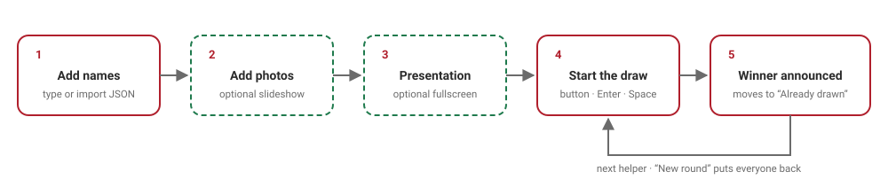

# Benutzerhandbuch



## 1. Namen hinzufügen

- Namen in das Feld **„Enter name…“** eingeben und mit **Enter** oder **Add** bestätigen.
- Doppelte Namen werden abgelehnt; Leerzeichen werden bereinigt (max. 60 Zeichen, max. 500 Namen).
- Die Liste wird automatisch im Browser gespeichert (`localStorage`) und ist beim nächsten Besuch wieder da.
- Über das Papierkorb-Symbol werden einzelne Namen entfernt.

### Import / Export

- **Export** lädt die aktuelle Liste als `names.json` herunter.
- **Import** liest eine JSON-Datei ein und ergänzt die vorhandene Liste (Duplikate werden zusammengeführt).

Unterstützte Formate:

```json
["Anna", "Ben", "Clara"]
```

```json
{ "names": ["Anna", "Ben", "Clara"] }
```

## 2. Bilder für die Slideshow (optional)

- **Upload pictures** akzeptiert beliebig viele Bilddateien (max. 15 MB pro Bild, max. 100 Bilder).
- Die Bilder wechseln automatisch alle 4 Sekunden und können über Pfeile bzw. Punkte manuell gewechselt werden.
- Bilder werden **nicht** gespeichert oder hochgeladen – sie existieren nur im aktuellen Browser-Tab.

## 3. Präsentationsmodus (optional)

- **Presentation mode** schaltet in den Vollbildmodus und blendet die Einstellungen aus. Die Bühne wird automatisch an die Bildschirmgröße angepasst – ideal für Beamer und TV.
- Beenden über **Exit** oder die **ESC**-Taste.

## 4. Auslosung starten

- **Start selection** klicken oder **Enter** / **Leertaste** drücken (solange kein Eingabefeld fokussiert ist).
- Während der Animation spielt ein zufälliger Weihnachts-Jingle.
- Nach ca. 6 Sekunden steht der Gewinner fest und wird **aus der Liste entfernt** – so kommt jede Person genau einmal dran.

## Tastenkürzel

| Taste             | Aktion                        |
| ----------------- | ----------------------------- |
| `Enter` / `Space` | Auslosung starten             |
| `Enter` im Feld   | Namen hinzufügen              |
| `Esc`             | Vollbild/Präsentation beenden |

## Fairness

Die Auswahl verwendet die Web Crypto API (`crypto.getRandomValues`) mit Rejection Sampling. Jede Person hat exakt die gleiche Wahrscheinlichkeit – ohne den Modulo-Bias einfacher Zufallsfunktionen.

## Datenschutz

Es werden keine Daten an Server übertragen. Es gibt kein Tracking, keine Cookies und keine externen Schriften oder Skripte. Zum Löschen aller Daten genügt es, die Websitedaten im Browser zu entfernen.

## Fehlerbehebung

| Problem                       | Lösung                                                                                                                 |
| ----------------------------- | ---------------------------------------------------------------------------------------------------------------------- |
| Kein Ton                      | Browser blockiert Autoplay – einmal auf die Seite klicken, Lautstärke prüfen.                                          |
| Vollbild startet nicht        | Manche Browser (z. B. iOS Safari) unterstützen die Fullscreen-API nicht; der Präsentationsmodus funktioniert trotzdem. |
| Liste nach Neustart leer      | Privater Modus oder blockierter Speicher – Liste vorher exportieren.                                                   |
| „Start selection“ deaktiviert | Es ist kein Name (mehr) in der Liste.                                                                                  |
